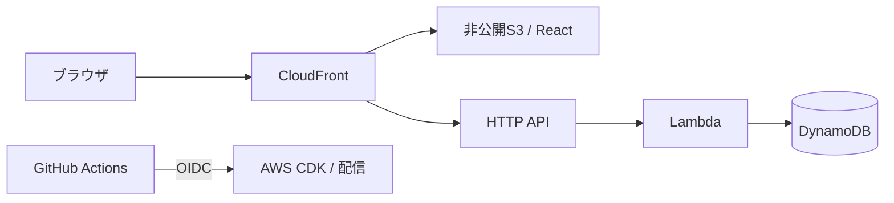

# AI Web App Starter for AWS

Reactの画面、Lambda API、DynamoDB、S3 + CloudFront配信を備えた、AIを使ったWebアプリ開発の出発点です。開発工程のドキュメントとAWSの基本構成を用意しています。

## 最初にできること

- 公開サイトに `Hello World` を表示します。
- `/api/hello` はLambdaからDynamoDBのサンプルレコードを読み、画面に返します。
- GitHub ActionsがPull Requestと`main`へのマージ後に検証します。本番デプロイは利用者がActions画面から手動実行します。
- GitHub Issueで`@claude`または`@codex`を使い、ブラウザから実装を依頼できます。`@codex`はCodexのGitHub連携で動作し、このリポジトリのActionsは不要です。
- 目的・要件・設計・テスト・実装・リリースの雛形を`docs/`と`tasks/`に用意しています。

## 構成



| 場所 | 内容 |
| --- | --- |
| `apps/web/` | React + TypeScript + Viteの静的画面 |
| `apps/api/` | TypeScriptのサンプルLambda |
| `infra/` | AWS CDKとGitHub OIDC初期設定用CloudFormation |
| `.github/workflows/` | 検証、AWSデプロイ、Claude Code連携 |
| `docs/`, `tasks/`, `prompts/` | AI開発の進め方と各工程の雛形 |

## ブラウザだけで始める

1. GitHubの **Use this template** から自分のリポジトリを作ります。
2. [環境構築手順](docs/TEMPLATE_SETUP.md)に従い、AWSとGitHubを設定し、AI開発ツールはClaude CodeまたはChatGPT Codexのどちらか一方を接続します。両方のアカウントは不要です。
3. GitHub Actionsの `CI and deploy` で`main`を選び、`deploy`をオンにして手動実行します。表示されたCloudFront URLを開きます。
4. [Issueから開発する手順](docs/DEVELOPMENT_WORKFLOW.md)に従い、最初の機能を作ります。

アカウントと課金設定、GitHubの設定、AWSの初期設定はブラウザで行えます。ローカルCLIは必須ではありません。AWSとAIサービスの利用料金は各自のアカウントに発生します。

## テンプレートから作った後に書き換える箇所

- [ ] `README.md`の題名・説明を自分のプロジェクトに合わせる
- [ ] `LICENSE`の著作権者を変更する
- [ ] ルートと各`package.json`の名前（`ai-native-development-template-aws`、`@starter/*`）を必要に応じて変更する
- [ ] 同じAWSアカウントに複数プロジェクトを置く場合は、Repository variablesの`STACK_NAME`でスタック名を変える
- [ ] `docs/00-project-brief.md`から順に記入し、`tasks/STATUS.md`の日付を更新する

## 開発ルール

最初に`AGENTS.md`を読み、`docs/00-project-brief.md`から順番にプロジェクト固有の内容を埋めます。承認済みdocs/tasksを正本とし、Issueには対象タスク、変更範囲、完了条件、テスト方針を書きます。Pull Requestで検証結果と差分を確認してから`main`へマージします。リリース時は利用者がActionsから本番デプロイを手動実行します。

依存関係に更新があるとDependabotがPull Requestを作ります。件数が増える理由と確認方法は[環境構築手順](docs/TEMPLATE_SETUP.md)の「Dependabotの更新PR」を参照してください。

## コマンド（ローカルで使う場合）

```sh
corepack enable
pnpm install --frozen-lockfile
pnpm verify   # 型チェック・テスト・ビルド・CDK synth
pnpm dev      # 画面をローカル起動（/api/hello はAWSに接続しないモック応答）
```

Node.js 24系とpnpm 10.14.0を使用します。ブラウザだけで進める場合、これらはGitHub ActionsおよびClaude/Codexのクラウド環境が実行します。

## 初期構成の範囲

サンプルAPIは認証なしの読み取り専用です。API GatewayはCloudFrontを経由せず直接呼ぶこともでき、スロットリング（10 req/s、バースト20）だけで保護しています。アプリ固有の認証、書き込みAPI、独自ドメイン、監視通知などは要件を決めてから追加します。DynamoDBテーブルとS3バケットはスタック削除時も保持します。
