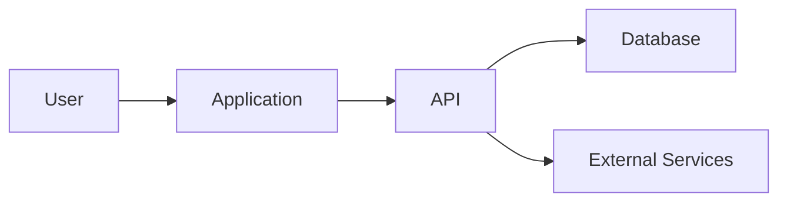
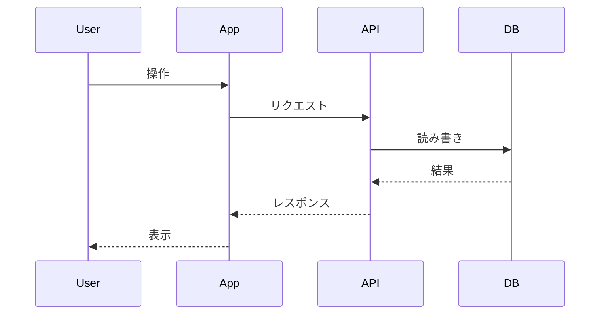

# 03. Architecture

このドキュメントは、システム構成、技術スタック、データフロー、運用構成を整理するためのテンプレートです。

## 前提

- 参照する要件定義: `docs/01-requirements.md`
- 参照する非機能要件: `docs/02-non-functional-requirements.md`
- 対象リリース:
- 作成日:
- 最終更新日:

## システム概要

-

## 推奨アーキテクチャ

### 構成図

### 構成要素

| コンポーネント | 役割 | 技術候補 | 備考 |
| --- | --- | --- | --- |
| Frontend |  |  |  |
| Backend |  |  |  |
| Database |  |  |  |
| Storage |  |  |  |
| Auth |  |  |  |
| Monitoring |  |  |  |

## 技術スタック

| 領域 | 推奨案 | 代替案 | 採用理由 |
| --- | --- | --- | --- |
| Frontend |  |  |  |
| Backend |  |  |  |
| Database |  |  |  |
| Infrastructure |  |  |  |
| Testing |  |  |  |
| CI/CD |  |  |  |

## 技術選定の比較

### 選択肢A

- メリット:
- デメリット:
- コスト:
- リスク:

### 選択肢B

- メリット:
- デメリット:
- コスト:
- リスク:

### 採用案

-

### 採用理由

-

## データフロー

## API構成

| API領域 | 目的 | 関連機能 |
| --- | --- | --- |
|  |  |  |

詳細は`docs/04-api-design.md`に記載します。

## データベース構成

| データ領域 | 主なデータ | 関連機能 |
| --- | --- | --- |
|  |  |  |

詳細は`docs/05-database-design.md`に記載します。

## 認証・認可

-

## セキュリティ方針

-

## デプロイ構成

| 環境 | 用途 | デプロイ方法 | 備考 |
| --- | --- | --- | --- |
| Local | 開発 |  |  |
| Staging | 検証 |  |  |
| Production | 本番 |  |  |

## 監視構成

-

## 主要リスク

| リスク | 影響 | 対応方針 |
| --- | --- | --- |
|  |  |  |

## 確定事項

-

## 仮定

-

## 未決定事項

-

## 確認したい事項

-

## 承認ゲート

- [ ] 技術スタックの推奨案と代替案を確認した
- [ ] 採用理由が明確である
- [ ] データフローが要件と整合している
- [ ] セキュリティ方針が非機能要件と整合している
- [ ] 次の詳細設計フェーズに進むことを承認した
