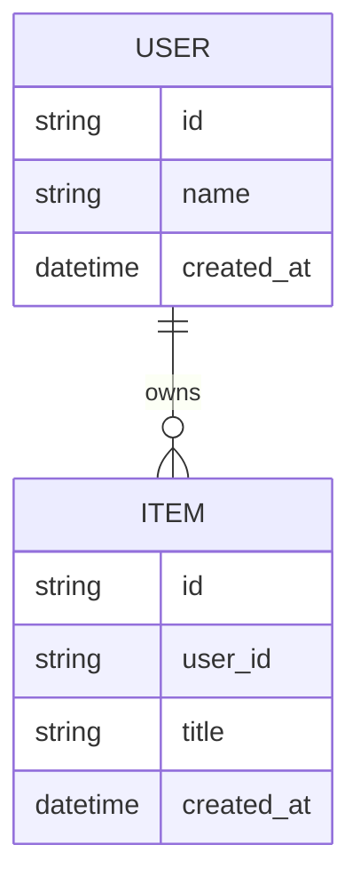

# 05. Database Design

このドキュメントは、データモデル、テーブル、リレーション、保持方針を整理するためのテンプレートです。

## 前提

- 参照する基本設計: `docs/03-architecture.md`
- 対象リリース:
- 作成日:
- 最終更新日:

## データ設計方針

-

## ER図

## テーブル一覧

| テーブル | 用途 | 関連機能 | 備考 |
| --- | --- | --- | --- |
| users |  |  |  |

## テーブル詳細

### users

#### 概要

-

#### カラム

| カラム | 型 | 必須 | 一意 | 初期値 | 説明 |
| --- | --- | --- | --- | --- | --- |
| id |  | Yes | Yes |  |  |
| created_at | datetime | Yes | No | now |  |
| updated_at | datetime | Yes | No | now |  |

#### インデックス

| 名前 | カラム | 種別 | 用途 |
| --- | --- | --- | --- |
|  |  |  |  |

#### 制約

-

#### 権限

-

#### 保持期間

-

#### 削除方針

-

## マイグレーション方針

-

## 初期データ

-

## バックアップ・復元

-

## データ移行

-

## 個人情報・機密情報

| データ | 種別 | 保存場所 | 保護方法 | 保持期間 |
| --- | --- | --- | --- | --- |
|  |  |  |  |  |

## 確定事項

-

## 仮定

-

## 未決定事項

-

## 確認したい事項

-

## 承認ゲート

- [ ] データモデルが機能要件と対応している
- [ ] 個人情報・機密情報の扱いが明確である
- [ ] マイグレーション方針が明確である
- [ ] バックアップ・復元方針が明確である
- [ ] DB設計を承認した
